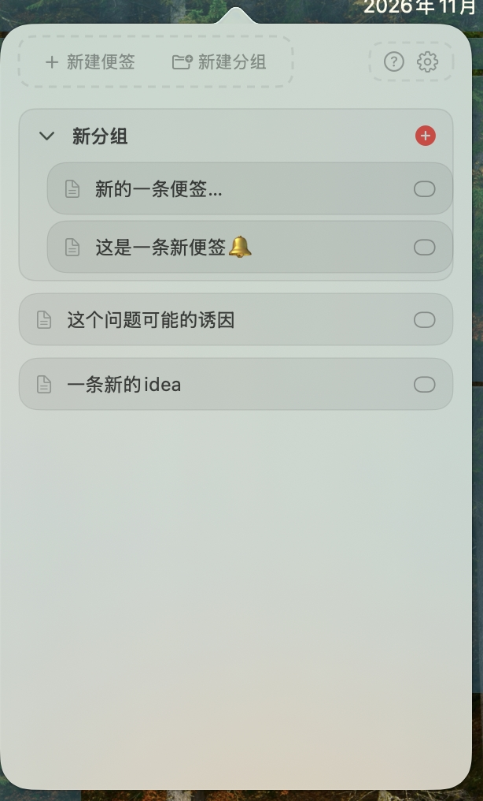
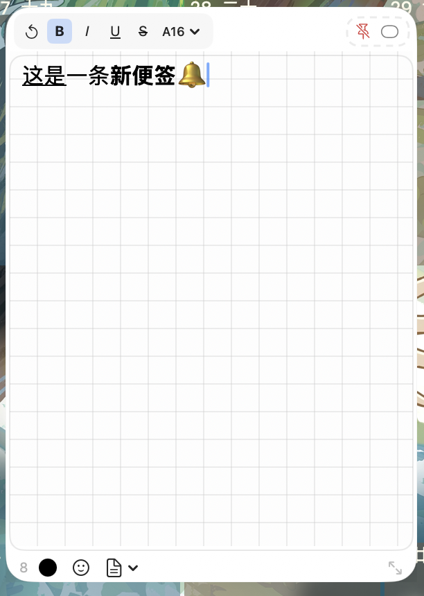

<p align="center">
  
</p>

# PinNote

PinNote 是一个 macOS 菜单栏便签 App：极简圆角卡片风格，支持分组、钉到屏幕、胶囊模式。
同时提供 Windows 托盘版，见下方「版本更新」。

-----

## 版本更新

### Windows 版（2026-11）

Windows 版已完成，入口改为**系统托盘**（替代 macOS 菜单栏），功能与 macOS 版对齐：
托盘面板、分组 / 拖拽、悬浮窗富文本、5 种纸张背景、胶囊吸附 / 悬停预览、设置 / 帮助、
Ctrl 快捷键、钉住、字符数、40 色调色板、菜单栏配色下拉。

<p align="center">
  
</p>

-----

## 功能

- **菜单栏界面**：新建便签 / 新建分组，点击便签弹出悬浮窗；便签支持拖入 / 拖出分组；一键吸附屏幕边缘按钮

----
<p align="center">
  
</p>

----

- **悬浮窗**：富文本编辑（粗体 / 斜体 / 下划线 / 删除线 / 字号下拉 / 49 色 / emoji），编辑框实时显示字符数
- **编辑区背景**：空白页、点阵页、虚线格、网格本、木质纹理，一键切换并记住选择
- **钉住**：窗口钉在屏幕并保持最前（全屏切换也不掉）；初次钉住吸附屏幕左侧、以最小尺寸打开，之后记住每次调整的位置和大小

----
<p align="center">
  
</p>

----

- **胶囊模式**：悬浮窗变为半圆胶囊吸附屏幕左 / 右边缘（按悬浮窗所在半屏决定），不同便签显示不同颜色圆点；悬停展开预览，拖拽后记住吸附位置，点击恢复悬浮窗

----
<p align="center">
  
</p>

----

- **设置**：开机自启动、数据导出 / 导入

-------

## Requirements

- macOS 14.0 or later
- Apple Silicon or Intel (build with `ARCHS="arm64 x86_64"` for Intel support)


**下载 / 分发**

Windows 版只提供 **.NET Framework 4.8 单文件构建**（约 1.2 MB），不再提供 .NET 8 版本：

- 文件：`PinNote-win64.zip`（约 1.1 MB，含 exe、`PinNote.exe.config`、使用说明）；
- 系统：Windows 10 1903+ / Windows 11 64 位，系统自带 .NET Framework 4.8；
- 更老的 Windows 10 如果没有 4.8，需要先安装 .NET Framework 4.8 运行时；
- 可以直接上传到 GitHub 普通仓库（远低于 25 MB 限制）。

- 首次运行会自动打开面板；程序是托盘 App，没有主窗口，之后从托盘图标打开、右键退出。
- 从网页下载的 exe 未签名，可能被 SmartScreen 拦截：点“更多信息 → 仍要运行”，
  或右键 exe → 属性 → 勾选“解除锁定”。
  
**与 macOS 版的平台差异**

- 系统托盘代替菜单栏；Ctrl 系列快捷键代替 ⌘；
- 透明窗口下 WPF 使用灰度抗锯齿，小字号会比原生应用略软；悬浮时不再缩放或加 Effect；
- 毛玻璃是“截屏 + 高斯模糊 + 染色”的静态材质，不是系统级实时模糊；
- Windows 版调色板严格按源码的 8×5 = 40 色；原 README 的“49 色”与源码不一致；
- 编辑区内的 emoji 为单色（WPF 文本引擎限制），卡片标题 / 预览 / 胶囊 / 选择器使用彩色 emoji 图片；
- 数据在 `%APPDATA%\PinNote`，可以直接导入 macOS 的 `pins.json`；
  Windows 的富文本 `attributedData` 为 RTF，导回 Mac 时会回退到纯文本。

**构建（Windows）**

```powershell
cd PinNoteWin
powershell -ExecutionPolicy Bypass -File .\build.ps1
```

产物：`dist\PinNote.exe`（约 1.2 MB 单文件）、`PinNote-win64.zip`。
详细说明、快捷键、数据迁移与已知问题：[PinNoteWin/README.md](PinNoteWin/README.md)

------

## 构建

macOS 源码位于 `Example/PinNote`（独立 git 仓库）：

```bash
cd Example/PinNote
bash build.sh
```

生成 Xcode 工程，编译并打包 DMG。如需重新生成应用图标：

```bash
cd Example/PinNote
bash generate_icon.sh
```
-----

## 快捷键

| 快捷键 | 功能 |
|--------|------|
| ⌘N | 新建便签 |
| ⇧⌘N | 新建分组 |
| ⌘W | 关闭弹窗 |
| ⌘, | 设置 |
| ⌘/ | 帮助 |
| ⌘M | 悬浮窗切换为胶囊模式 |

Windows 版对应 Ctrl+N / Ctrl+Shift+N / Ctrl+W / Ctrl+, / Ctrl+/ / Ctrl+M。

------

## License

MIT

## Support

If you find PinNote helpful, consider supporting its development:

- **感谢赞助** — 如果 PinNote 对你有帮助，欢迎扫码赞助一杯咖啡 ☕
- <p align="center">
  
  
</p>

Your support helps cover developer costs and motivates continued improvement. Thank you! 🙌
